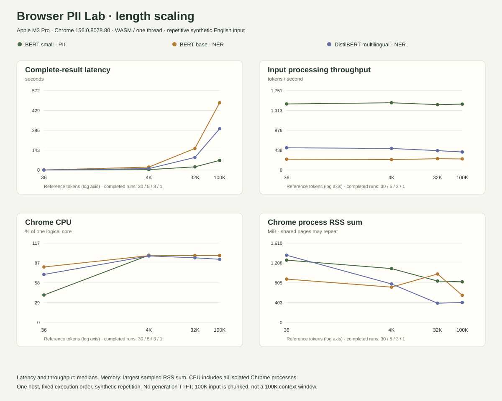

# Measured results

Measured locally in Chrome 156.0.8078.80 on Apple M3 Pro (11 logical cores, 18 GiB RAM). Resource run began 2026-11-06T14:14:20.154Z UTC / Fri Nov 06 2026 22:14:20 GMT+0800 (China Standard Time). Inference source commit: `9eaee0dfd734309c107e9e9a3003dbf77d62e001`.

For the interactive view, run the app and open [report.html](../report.html). It lets you select input length and metric and inspect memory traces. Raw resource data: [measurements.json](../public/measurements.json). Inputs and checksums: [data](../data).

## Length scaling

The same synthetic English file is used for each model. Actual per-model input tokens include special tokens for each chunk and therefore differ from the whole-document reference token count. All rows below are warmed model runs; first-download observations are separate in the JSON and interactive report.

| Model | Reference size | Completed / failed | Actual tokens | Chunks | Median complete ms | p95 ms | Input tokens/s | CPU % | Baseline RSS MiB | Peak RSS MiB |
|---|---:|---:|---:|---:|---:|---:|---:|---:|---:|---:|
| gravitee | short | 30 / 0 | 36 | 1 | 24.7 | 33 | 1,457.5 | 40.4 | 1,093 | 1,264.5 |
| gravitee | 4k | 5 / 0 | 4,125 | 14 | 2,779.6 | — | 1,484 | 98.8 | 1,057.5 | 1,093.2 |
| gravitee | 32k | 3 / 0 | 32,969 | 105 | 22,855 | — | 1,442.5 | 98.1 | 810.7 | 840.6 |
| gravitee | 100k | 1 / 0 | 100,630 | 318 | 69,228.7 | — | 1,453.6 | 98.4 | 786.9 | 825.4 |
| bert | short | 30 / 0 | 42 | 1 | 175.8 | 202.2 | 238.9 | 81.6 | 848.1 | 880.2 |
| bert | 4k | 5 / 0 | 4,848 | 14 | 21,082 | — | 230 | 98.2 | 621.6 | 716.3 |
| bert | 32k | 3 / 0 | 38,750 | 105 | 155,558.1 | — | 249.1 | 98.5 | 853.9 | 983.5 |
| bert | 100k | 1 / 0 | 118,276 | 318 | 484,468 | — | 244.1 | 98.3 | 521.6 | 551.8 |
| distilbert | short | 30 / 0 | 42 | 1 | 85.7 | 97.8 | 490.1 | 70.6 | 982.7 | 1,364.4 |
| distilbert | 4k | 5 / 1 | 4,848 | 14 | 10,204 | — | 475.1 | 97.7 | 724.6 | 781.5 |
| distilbert | 32k | 3 / 0 | 38,750 | 105 | 90,653.3 | — | 427.5 | 95 | 350.8 | 391.2 |
| distilbert | 100k | 1 / 0 | 118,276 | 318 | 297,219.1 | — | 397.9 | 92.9 | 380.4 | 404.8 |

CPU 100% means one logical core; this is whole-Chrome CPU, not model-exclusive CPU. RSS sums can double-count shared pages and include browser/runtime overhead. Peaks are sampled, not guaranteed maxima. The worker is not reset between increasing lengths; GC and prior allocations can lower or raise later RSS baselines. Short-request CPU is especially sensitive to measurement overhead. p95 uses nearest rank and is omitted below 20 observations.

## Detection quality smoke test

Source commit: `ad7eb56ac14f1f6a31f6be2ae84215ec6219996a`. [Raw predictions, provenance and per-category/language scores](chromium-smoke.json). Only 16 public synthetic fixtures; these were visible during implementation and are not an independent holdout. Full-task scores include email/phone/IP; shared scores include only person/organization/location. All adapters share Offthread postprocessing.

| Configuration | Full precision | Full recall | Full F1 | Shared NER F1 | Failures |
|---|---:|---:|---:|---:|---:|
| regex | 100% | 36.8% | 53.8% | 0% | 0 |
| gravitee:model | 80% | 63.2% | 70.6% | 66.7% | 0 |
| gravitee:hybrid | 82.4% | 73.7% | 77.8% | 66.7% | 0 |
| bert:model | 100% | 42.1% | 59.3% | 80% | 0 |
| bert:hybrid | 100% | 78.9% | 88.2% | 80% | 0 |
| distilbert:model | 91.7% | 57.9% | 71% | 91.7% | 0 |
| distilbert:hybrid | 94.7% | 94.7% | 94.7% | 91.7% | 0 |

## Interpretation limits

- These BERT models return classified spans rather than streaming generated tokens. Complete-result latency and first-chunk completion are not generation TTFT. Tokens/s is input processing throughput.
- Long inputs are chunked. The 100K tier is one complete run per model, not a p95 estimate or evidence of a 100K context window.
- Resource measurements were sequential on one host with fixed model/length order. Other applications, thermal state, and filesystem/network caches were not controlled. Browser process sampling adds overhead.
- The long corpus is deliberately repetitive and includes only one English template. It tests scaling and plumbing, not long-document accuracy, varied languages or realistic privacy coverage.
- Model quality differences on this tiny set do not establish statistical superiority. Do not choose a production model from these scores alone.
- Safari, real mobile hardware and other operating systems remain unverified.

## Reproduce

Run `bun install --frozen-lockfile`, `bun test`, `bun run build`, then `bun run preview --port 4187 --strictPort`. In another terminal run `bun run benchmark`, then `bun run profile`, then `bun run report:generate`. Do not run benchmark and profiler simultaneously. Rebuild to include updated measurements in the static report.

## Interrupted and resumed session

Renderer processes exited and initial host driver stalled; cause unconfirmed. Partial successful measurements preserved in results/profile-interrupted.json. No timing value invented for the interrupted attempt.

The resumed profiler source is archived at `provenance/profiler-session-1.ts.txt`; its SHA-256 matches the raw session metadata. Initial inference code is pinned by the commit above. Resuming restarts the browser and changes memory/cache baselines; the 32K BERT observations span two sessions.

## Run accounting and downloads

117 successful warmed requests; 2 recorded failed attempts across all phases; 1 separately documented interruption. Completed and failed trial counts are shown separately; failed timings do not become zero-duration successes. The profiler retains a nonzero exit status when its history contains failures, even after successful resumption.

Download [resource-summary.csv](resource-summary.csv), [quality-summary.csv](quality-summary.csv), [raw browser quality results](chromium-smoke.json), [raw resource samples](../public/measurements.json), or [browser test evidence](browser-checks.json).
